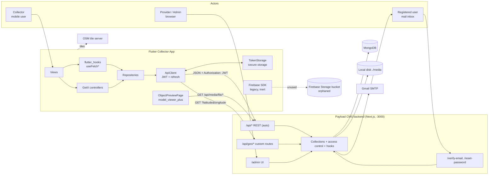

# ViMu — System Architecture (as-is)

> **Snapshot:** 2026-11-15
> **Backend:** `vimu_payload` @ `dev` (`8997dbc`)
> **App:** `Collector_App/vimu_collector_app/collector_app` @ `develop` (`0dad6b0`)
> **Diagram:** [`vimu-system-architecture.excalidraw`](./vimu-system-architecture.excalidraw). Open it at [excalidraw.com](https://excalidraw.com) (File → Open) or with the VS Code *Excalidraw* extension.

This document describes the system **as it is implemented today**. It is not a target design. Use it as the starting point for planning further work. When the architecture changes, update this file and the diagram in the same PR.

---

## 1. Overview

ViMu has three parts:

1. **Flutter Collector App.** The mobile client for end users ("collectors"). Users find valuables (artefacts and sights) near their location, look at them (including a 3D model), and "collect" them.
2. **Payload CMS backend.** A Next.js app with Payload 3 embedded. It provides the REST API, custom geo endpoints, the admin UI for content editors, and the web pages that email links point to.
3. **Storage.** MongoDB holds all structured data. The local disk (`./media`) holds all uploaded files (images and `.glb` 3D models). Gmail sends the transactional emails.

**Firebase / Cloud Storage is no longer part of any live data path.** Before the Payload refactor (app commit `7c7e43d`, Jul 2026), the app loaded `.glb` models from the Firebase Storage bucket `collectclient.firebasestorage.app`. That code was removed. All media now comes from Payload. What remains of Firebase in the app is inert: the startup init call, an unused helper, unused packages and a template scaffold (see §6).

---

## 2. Flutter Collector App

**Location:** `C:\Users\Bene\Documents\ViMu\Collector_App\vimu_collector_app\collector_app`
**Stack:** Flutter / Dart ≥ 3.3, GetX (routing, DI, controllers), `flutter_hooks` (data fetching), `http`, `flutter_secure_storage`, `flutter_map` (OpenStreetMap), `geolocator`, `model_viewer_plus`, `cached_network_image`.

### 2.1 Layers

| Layer | Path | Responsibility |
|---|---|---|
| Views | `lib/views/**` | Screens. `entrypoint.dart` has 4 bottom tabs: Home, Search, Map, Profile. Detail pages: Site, Valuable, Category, Collect, Collected ("Vault"), ObjectPreview (3D). Auth: Login, Register, Forgot password, LoginRedirect. |
| Data hooks | `lib/hooks/*.dart` | 11 `useFetch*()` hooks. Each one calls `determinePosition()` (GPS), then a repository, and returns `FetchHook{data,isLoading,error,refetch}`. |
| Controllers | `lib/controllers/*.dart` | GetX controllers. `AuthController` keeps the session in memory (loaded once in `main()` via `bootstrap()`). Login / Registration / ForgotPassword / Collect / SearchValuable call repositories. TabIndex / Category / Valuable / UserLocation hold UI state. |
| Repositories | `lib/repositories/*.dart` | One class per backend resource. Each one maps Payload JSON to `lib/models/*`. `ProvidersRepository` exists but nothing calls it. |
| Services | `lib/services/*.dart` | `ApiClient` (HTTP, JWT, refresh, error normalisation), `TokenStorage` (secure storage), `location_service` (GPS, fallbacks, `openMaps()`), `tile_provider` (OSM layer), `glb_downloader` (legacy Firebase, unused). |
| Models | `lib/models/*.dart` | `ValuableModel`, `SiteModel`, `CategoryModel`, `ProviderModel`, `MediaModel`, `UserValuable`, `AppUser`, `AuthSession`, `ApiError`. |

### 2.2 Networking: `ApiClient`

- **Base URL:** `appBaseUrl` in `lib/constants/constants.dart`. It is hard-coded to a LAN IP (`http://192.168.0.193:3000`). There are no build flavors or environments.
- **Auth header:** `Authorization: JWT <token>`. The app does not use cookies.
- **Refresh before expiry:** before every non-auth request, if the token expires in less than 5 minutes, the client calls `POST /api/users/refresh-token`.
- **Refresh after rejection:** on a `401`/`403`, the client refreshes once and retries. If the refresh fails, it clears the session and sends the user to `LoginRedirect` (Payload returns 403 for both "unauthenticated" and "forbidden", so a failed refresh is the only reliable sign of an expired session).
- **Errors:** Payload's `{errors:[{message}]}` and `{message}` shapes become `ApiException(ApiError)`.
- Android has `usesCleartextTraffic="true"`, so plain HTTP to the LAN dev server is allowed.

### 2.3 Session storage: `TokenStorage`

`flutter_secure_storage` (iOS Keychain / Android Keystore) stores three keys: `auth_token`, `auth_token_exp` and `auth_user` (JSON). It replaced the older plaintext `GetStorage`. `GetStorage.init()` still runs in `main()`.

### 2.4 Media and 3D

- `MediaModel.fullUrl` takes the path from the URL that Payload returns and rebuilds the URL against `appBaseUrl`. This is needed because Payload builds media URLs from its own `serverURL` (e.g. `localhost`), which a device can't reach.
- Images load through `cached_network_image` from `GET /api/media/file/<filename>`.
- 3D: `ObjectPreviewPage` uses `model_viewer_plus` with `src = valuable.mediaFiles[0].fullUrl`. The `.glb` file is stored in Payload media. The WebView serves its bundle from a random localhost port, so the `.glb` request is cross-origin. This is why the backend sets `cors: '*'`.

### 2.5 Maps and location

- The map uses `flutter_map` with OpenStreetMap tiles from `tile.openstreetmap.org` and the user agent `com.vimu.collector_app`. `google_maps_flutter` is a dependency but is not used.
- `geolocator` provides GPS. If the device reports the emulator's default location, the app uses a Kiel location instead. If GPS fails, `UserLocationController` falls back to London.
- Directions open Google Maps or Apple Maps through `url_launcher` deep links.

### 2.6 Tests

`test/` covers `ApiClient`, `AuthRepository`, `ValuablesRepository`, `UserValuablesRepository` and `MediaModel` (with mocktail).

---

## 3. Payload CMS backend

**Location:** this repo (`vimu_payload`)
**Stack:** Next.js 16.2 (App Router), Payload 3.85.1, TypeScript, `@payloadcms/db-mongodb`, `@payloadcms/email-nodemailer`, `@payloadcms/richtext-lexical`, `sharp`. Everything runs as one Node process on port 3000.

### 3.1 HTTP surface

| Surface | Source | Used by |
|---|---|---|
| REST API (auto-generated, full CRUD per collection) | `src/app/(payload)/api/[...slug]/route.ts` | App (auth, user-valuables, providers, media files), admin UI |
| Custom geo routes `/api/geo/*` | `src/app/(payload)/api/geo/**/route.ts` | App (all discovery screens) |
| Admin UI `/admin` | `src/app/(payload)/admin/**` | Providers and admins (browser) |
| Web pages `/verify-email`, `/reset-password` | `src/app/(frontend)/**` | Users clicking email links |
| GraphQL `/api/graphql`, `/api/graphql-playground` | `src/app/(payload)/api/graphql*` | Nobody (on by default) |
| `/my-route` | `src/app/my-route/route.ts` | Nobody (left over from the template) |

### 3.2 Endpoints the app calls

| App call | Endpoint | Handler | Auth |
|---|---|---|---|
| `AuthRepository.register` | `POST /api/users` | Payload REST | public |
| `AuthRepository.login` | `POST /api/users/login` | Payload REST | public |
| `AuthRepository.refreshToken`, `ApiClient._refresh` | `POST /api/users/refresh-token` | Payload REST | JWT |
| `AuthRepository.logout` | `POST /api/users/logout` | Payload REST | JWT |
| `AuthRepository.forgotPassword` | `POST /api/users/forgot-password` | Payload REST | public |
| `CategoriesRepository.all` / `top` | `GET /api/geo/categories`, `/api/geo/categories/top` | `geo/categories/**` | public |
| `SitesRepository.random` / `closest` / `byId` | `GET /api/geo/sites/{random,closest,by-id/:id}` | `geo/sites/**` | public |
| `ValuablesRepository.random` / `closest` / `byId` | `GET /api/geo/valuables/{random,closest,by-id/:id}` | `geo/valuables/**` | public |
| `ValuablesRepository.bySite` / `byProvider` / `byCategory` / `byTag` | `GET /api/geo/valuables/by-{site,provider,category,tag}/:x` | `geo/valuables/**` | public |
| `UserValuablesRepository.collect` | `POST /api/user-valuables?depth=3` | Payload REST + `beforeChange` hook | JWT |
| `UserValuablesRepository.listMine` | `GET /api/user-valuables?depth=3` | Payload REST (access returns only the user's own records) | JWT |
| `ProvidersRepository.byId` (not called) | `GET /api/providers/:id?depth=1` | Payload REST | public |
| Images / 3D | `GET /api/media/file/:filename` | Payload upload static handler | public |

All geo routes except `categories` require `?latitude=&longitude=` and return `400` without them. `random` takes an optional `limit` (default 5 for sites, 15 for valuables). `closest` and the `by-*` list routes are not paginated and return every match sorted by distance.

### 3.3 How the geo routes work (`src/lib/geo.ts`)

1. `parseLatLng` / `parseLimit` read the query params.
2. `geoNearIds` runs a `$geoNear` aggregation directly on the underlying mongoose model (`payload.db.collections[...]`). It returns `{_id, distance}` (distance in metres) and can add a `$sample` stage (for `random`) and an extra match (`relationEqualsFilter` for site/provider/category, `tags.tag` for tag).
3. `hydrateGeoMatches` loads the full documents with `payload.find({ where: { id: { in } }, depth: 2 })`, so access control, hooks and population all apply. It then restores the distance order and adds the `distance` field.
4. The `by-id` routes use `payload.findByID` and compute `haversineDistance` in JS.

Point fields are stored as `[lng, lat]`. Payload creates the `2dsphere` index that `$geoNear` needs.

### 3.4 Collections and data model

All collections also have `id`, `createdAt` and `updatedAt`. Relationships are stored as ObjectIds and populated through `?depth=N`.

| Collection | Key fields | Relations | Access |
|---|---|---|---|
| `users` (auth) | email, password, `_verified`, name, surname, nickname?, lastname?, **role** `client\|provider\|admin` (default `client`, `saveToJWT`) | — | create: public · read/update: self, or admin for all · delete: admin · `role` field create/update: admin only (others get the default `client`) |
| `media` (upload) | alt, filename, mimeType, filesize, url, width/height | — | read: public · write: provider or admin |
| `providers` | name | `user → users` | read: public · write: provider or admin |
| `sites` | title, time, address, isAvailable, location (point) | `provider → providers`, `image? → media`, `logo? → media` | read: public · write: provider or admin |
| `valuables` | title, type `Artefact\|Sight`, subtype? (14 values), data{title, artist?, year?, description?}, tags[]{tag}, price, location (point) | `site → sites`, `provider → providers`, `publisher → users`, `category → categories`, `images[].image → media`, `mediaFiles[].file → media` (the app treats `[0]` as the `.glb`) | read: public · write: provider or admin |
| `categories` | name (`"More"` is a special catch-all that `/top` always appends) | `icon → media` | read: public · write: provider or admin |
| `user-valuables` | price, paymentMethod `Stripe\|Paypal`, paymentStatus `Pending\|Completed\|Failed` (default Pending) | `user → users` (set from `req.user` by the `beforeChange` hook), `valuable → valuables` | read: own records (admin: all) · create: any logged-in user · update/delete: admin |

Access helpers are in `src/access/roles.ts`: `isProviderOrAdmin`, `isAdmin`, `isAdminField`.

### 3.5 Auth and email

- Payload's built-in auth on `users` signs JWTs with `PAYLOAD_SECRET`. `role` is included in the JWT.
- `auth.verify` is on, so a new account has to verify its email before it can log in. `auth.forgotPassword` is on too. Email HTML comes from `src/collections/Users/emails.ts`, and the links are built from `serverURL` (`NEXT_PUBLIC_SERVER_URL`).
- `/verify-email` calls `payload.verifyEmail()` on the server. `/reset-password` is a client form that posts to `/api/users/reset-password`.
- **Admins.** An admin is any user with `role: admin`. The first admin comes from `ADMIN_EMAIL` / `ADMIN_PASSWORD` at startup when the database has no admin (see §3.6). After that, admins manage roles in `/admin`; only admins can set `role`. Any logged-in user can open `/admin` (no `access.admin` rule), which is intended for the planned provider self-onboarding.
- Email goes through nodemailer with Gmail (`AUTH_EMAIL` / `AUTH_PASSWORD`, an app password). `skipVerify: true` skips the SMTP check at boot.

### 3.6 Configuration (`.env`)

| Variable | Purpose |
|---|---|
| `DATABASE_URL` | MongoDB connection string (local, or the `mongo` service in `docker-compose.yml`) |
| `PAYLOAD_SECRET` | JWT signing and encryption secret |
| `AUTH_EMAIL`, `AUTH_PASSWORD` | Gmail SMTP sender |
| `NEXT_PUBLIC_SERVER_URL` | Payload `serverURL`: base for email links and media URLs |
| `ADMIN_EMAIL`, `ADMIN_PASSWORD` (+ optional `ADMIN_NAME`, `ADMIN_SURNAME`) | First admin, created at startup by `src/lib/bootstrapAdmin.ts` (`onInit`) **only if no admin exists**. If the email already belongs to a user, that user is promoted. Never re-applied after that. |

`cors: '*'` is set on purpose (see §2.4). The JSDoc in `payload.config.ts` explains why.

### 3.7 Tests

- `tests/int/`: Vitest integration tests for access control, geo endpoints, user-valuables ownership and a basic API check.
- `tests/e2e/`: Playwright tests for the admin and frontend.

---

## 4. Storage

| Store | What lives there | Accessed by | Notes |
|---|---|---|---|
| **MongoDB** | All collection documents | Payload (mongoose adapter); `lib/geo.ts` also aggregates on the raw models | `src/migrations/` has 2 empty placeholder migrations |
| **Local disk `./media`** | Every upload: site images and logos, category icons (svg), valuable images, `.glb` models | Payload upload handler (`upload: true`, `sharp`) | Git-ignored. Exists only on the host that runs the server: no CDN, no backup, and it is lost when an ephemeral container is rebuilt. |
| **Firebase Storage** `collectclient.firebasestorage.app` | Older 3D models (`models/*.glb`) | Nothing at runtime | Orphaned. The app's `cors.json` allows GET from any origin. See §6. |

---

## 5. Key runtime flows

The numbers match the `[n]` labels in the diagram.

1. **Register.** The app sends `POST /api/users {name, surname, nickname?, email, password}`. Payload creates the user with `role=client` and sends a verify email through Gmail. The user opens `/verify-email?token=…` in a browser, the account is verified, and the user can log in in the app.
2. **Login / session.** The app sends `POST /api/users/login`, gets `{token, exp, user}`, saves it in `TokenStorage` and updates `AuthController`. Every later request sends `Authorization: JWT …`. The client refreshes the token before it expires or once after a 401/403, and logs the user out if the refresh fails.
3. **Discover.** A hook or controller gets the GPS position and calls `GET /api/geo/...?latitude&longitude`. The handler runs `$geoNear` on MongoDB, hydrates the documents (depth 2), adds `distance`, and the app turns them into models and renders them.
4. **Media / 3D.** The app builds the URL with `MediaModel.fullUrl` and loads `GET /api/media/file/<file>` (images, or `.glb` in `ObjectPreviewPage`). Payload streams the file from `./media`. No auth is needed.
5. **Collect.** `CollectController` sends `POST /api/user-valuables?depth=3 {valuable, price, paymentMethod}`. The `beforeChange` hook forces `user = req.user.id`, `paymentStatus` defaults to `Pending`, and the app navigates to the Vault. **No payment provider is connected.**
6. **Password reset.** The app sends `POST /api/users/forgot-password`. Payload sends the email, the user opens `/reset-password?token=…`, and the form posts to `/api/users/reset-password`.
7. **Content management.** A provider or admin logs into `/admin` and manages providers, sites, valuables, categories and media. Data goes to MongoDB and files to `./media`.

---

## 6. Firebase: what is left

| Item | Where | Status |
|---|---|---|
| `Firebase.initializeApp()` | `lib/main.dart` | Still runs at every app start, with nothing that needs it |
| `google-services.json`, `GoogleService-Info.plist` | `android/app`, `ios/Runner` | Project `collectclient`. Package names include `com.example.app` and `de.bentor.collector_client_app`. |
| `getGlbDownloadUrl()` | `lib/services/glb_downloader.dart` | Defined but never called (hard-coded `models/your_model.glb`) |
| `firebase_storage`, `firebase_auth`, `firebase_app_check` | `pubspec.yaml` | Only `firebase_storage` is imported, and only in the unused helper |
| `dataconnect/` | app repo root | Firebase Data Connect template (movie-review sample, all commented out). Not deployed and not used. |
| `cors.json`, `storage.rules` | app repo root | Bucket CORS config. `storage.rules` contains CLI error output, not real rules. |

**Decision needed:** you can either remove Firebase entirely, or reuse the bucket as Payload's object storage (see §8). Firebase Storage buckets are Google Cloud Storage buckets, so `@payloadcms/storage-gcs` can write to them directly.

---

## 7. Known risks and technical debt

Ordered roughly by priority. Each item was found by reading the code and has not been exploited or tested at runtime unless stated otherwise.

### Security / correctness

> **Fixed after the snapshot:** registration could set `role: "admin"` (the `role` field had no `create` guard), and any logged-in user could upload, overwrite or delete media (no write rules on `Media`). Both are now closed and covered in `tests/int/access-control.int.spec.ts`.

1. **No ownership checks for providers.** Any provider can update or delete any other provider's sites, valuables, categories and provider record. `valuables.publisher` and `provider` are set by the client, not derived from `req.user`.
2. **`user-valuables` trusts the client.** `price` and `paymentMethod` come from the client and are not checked against `valuable.price`. `paymentStatus` has no field-level access, so a client can probably send `"Completed"`. There is no duplicate-collect guard and no payment integration.
3. **Transport.** The app's base URL is a hard-coded LAN IP over cleartext HTTP. The JWT travels unencrypted on the local network. There is no build-flavor or environment config.
4. **`cors: '*'`.** Acceptable for now because the app authenticates with a header, not cookies. Revisit if cookie auth is ever used from a browser.

### Scalability / operations

5. **Uploads on local disk.** This blocks horizontal scaling and ephemeral or serverless hosting, and there is no backup or CDN.
6. **No deployment setup.** The `Dockerfile` expects `output: 'standalone'`, which `next.config.ts` does not set. `docker-compose.yml` is for development only.
7. **Unbounded geo queries.** `closest` and `by-*` have no `limit` or `maxDistance`, and every result is hydrated at depth 2. The cost grows linearly with the data.
8. **Heavy population.** `user-valuables` uses depth 3, so every collected item embeds the full valuable → site → provider tree.
9. **Placeholder migrations.** Both files in `src/migrations` are empty.

### Code hygiene

10. Unused app dependencies: `google_maps_flutter`, `flutter_cube`, `firebase_auth`, `firebase_app_check`, `phone_otp_verification`, `country_picker`, `device_preview`, and `get_storage` (only `init()` is called).
11. Unused backend surfaces: GraphQL, `/my-route`, and the template landing page at `/`.
12. `ProvidersRepository` is never called.
13. The `"More"` category is a magic name that both the backend (`/categories`, `/categories/top`) and the app depend on.
14. `subtype` and `type` enums exist only in `Valuables.ts`. The app treats them as plain strings.

---

## 8. Suggested next steps

These are starting points for planning, not decisions:

1. **Finish access control** (risks 1–2): ownership checks for providers, and server-side price/status for `user-valuables`, each with a test.
2. **Move uploads to object storage.** Add `@payloadcms/storage-gcs` (to reuse the Firebase/GCS bucket) or `@payloadcms/storage-s3`, then migrate the existing `./media` files. The app needs no changes as long as Payload keeps serving `/api/media/file/*`, or as long as `MediaModel.fullUrl` accepts absolute bucket or CDN URLs, which would need a small change.
3. **Decide on Firebase.** Either remove the SDK, packages, `dataconnect/` and the config files, or keep them only for the bucket from step 2.
4. **Environment config in the app.** Use `--dart-define` or flavors for `appBaseUrl`, use HTTPS outside development, and limit cleartext traffic to debug builds.
5. **Payments.** Design the real collect/payment flow (Stripe or PayPal webhooks set `paymentStatus` on the server) before `user-valuables` holds anything of value.
6. **Deployment.** Pick a hosting target, set `output: 'standalone'`, use managed MongoDB (e.g. Atlas, which supports `2dsphere`), and set up secrets.
7. **Geo endpoints.** Add `limit` / `maxDistance` and pagination, and consider a lighter depth for list views.

---

## 9. File index

**Backend (`vimu_payload`)**
- `src/payload.config.ts`: collections, adapters, CORS, email
- `src/collections/*.ts`: data model and access rules; `src/collections/Users/emails.ts`: email templates
- `src/access/roles.ts`: role helpers
- `src/lib/geo.ts`: `$geoNear` helpers
- `src/app/(payload)/api/geo/**/route.ts`: custom geo endpoints
- `src/app/(frontend)/{verify-email,reset-password}/page.tsx`: email link pages
- `src/payload-types.ts`: generated types (`pnpm generate:types`)
- `tests/int/*.int.spec.ts`: integration tests

**App (`collector_app`)**
- `lib/main.dart`: bootstrap (Firebase init, GetStorage, AuthController)
- `lib/constants/constants.dart`: `appBaseUrl`
- `lib/services/api_client.dart`, `lib/services/token_storage.dart`: networking and session
- `lib/repositories/*.dart`: endpoint mapping
- `lib/hooks/*.dart`, `lib/controllers/*.dart`: state and data loading
- `lib/models/media_model.dart`: media URL rewriting
- `lib/views/valuable/object_preview_page.dart`: 3D viewer
- `lib/services/glb_downloader.dart`, `dataconnect/`, `cors.json`, `storage.rules`: Firebase leftovers
