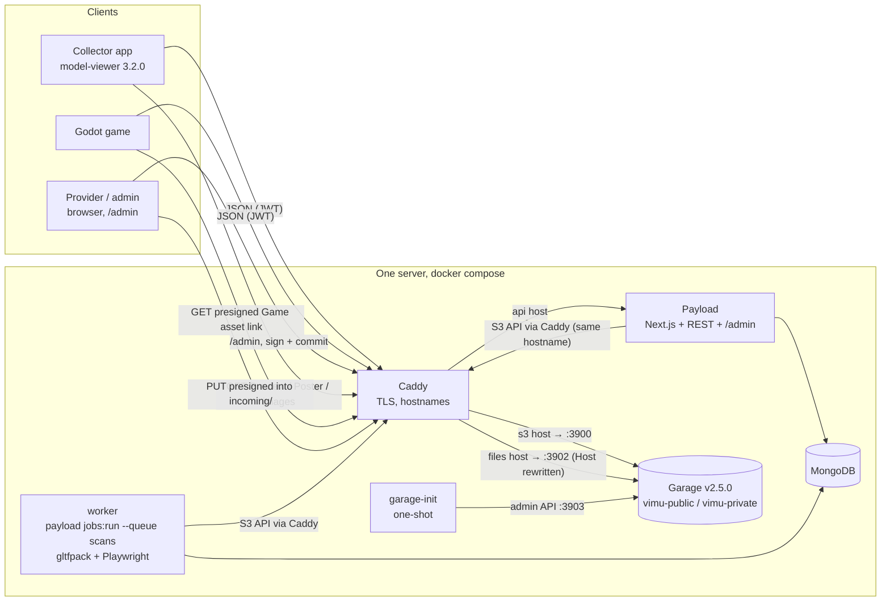

# Scan storage and delivery: spec

> **Status: planned, not implemented.** This is the target design from the map [#9](https://github.com/Bene97Kiel/vimu_payload/issues/9), settled in tickets #10–#21 (2026-11-15). [`ARCHITECTURE.md`](./ARCHITECTURE.md) describes what is built today; update it as each part of this spec lands. Turn this spec into implementation tickets with `/mattpocock-skills:to-tickets`.
>
> Vocabulary: [`GLOSSARY.md`](../GLOSSARY.md) (Scan, Rendition, Source, Game asset, Preview, Poster, UserValuable, Grant, Owner). Hard-to-reverse choices: [`docs/adr/`](../docs/adr/).

## 1. Goal

Every Valuable except AUDIO and MOVIE has one **Scan**, a textured 3D mesh. A Provider uploads the Scan's Game asset (and optionally its Source) in `/admin`. A worker validates it, generates a **Preview** for the collector app and a **Poster** for lists, and then makes it live. The collector app shows the Preview to everyone; the Godot game downloads the **Game asset**, but only for its **Owners**. All files live in an S3-compatible store, and no file bytes pass through Payload.

## 2. Decisions this builds on

| Ticket | Decision |
|---|---|
| [#10](https://github.com/Bene97Kiel/vimu_payload/issues/10) | Core shape: Payload is the only API and hands out presigned links after an ownership check ([ADR 0001](../docs/adr/0001-payload-is-the-only-api-for-scans.md)); two trust levels; GLB throughout; one Scan per Valuable; only the latest version is kept; only the server sets `price` and `paymentStatus`. |
| [#11](https://github.com/Bene97Kiel/vimu_payload/issues/11) | Research: Garage, SeaweedFS and RustFS compared; MinIO's community edition is archived. |
| [#12](https://github.com/Bene97Kiel/vimu_payload/issues/12) | Research: Payload's S3 adapter needs Payload ≥ 3.93; one public S3 hostname that also resolves inside Docker. |
| [#13](https://github.com/Bene97Kiel/vimu_payload/issues/13) | Research: Godot 4.7 rejects Draco, meshopt and quantized GLBs at runtime; the game caches by Scan id and checksum and resumes with Range requests. |
| [#14](https://github.com/Bene97Kiel/vimu_payload/issues/14) | Research: the app's viewer (`model-viewer` 3.2.0) decodes Draco and needs CORS `*`; Preview budget about 50k triangles (max 100k), 2048² JPEG, ≤ 3 MB (max 5 MB). |
| [#15](https://github.com/Bene97Kiel/vimu_payload/issues/15) | Research: gltfpack for the Preview, Playwright + `model-viewer` for the Poster, a Payload Jobs workflow in a separate worker container. |
| [#16](https://github.com/Bene97Kiel/vimu_payload/issues/16) | Garage `v2.5.0` single-node; SeaweedFS `weed mini` as the fallback; store-neutral credentials. |
| [#17](https://github.com/Bene97Kiel/vimu_payload/issues/17) | Game asset limits: target and hard max per metric; extension allowlist; checks in the worker. |
| [#18](https://github.com/Bene97Kiel/vimu_payload/issues/18) | Prototype: the generated Preview is good enough; recipe gltfpack `-sp` + JPEG 2048 + Draco; Posters are rendered automatically. |
| [#19](https://github.com/Bene97Kiel/vimu_payload/issues/19) | Upload flow: own `scans` collection and endpoints ([ADR 0002](../docs/adr/0002-scans-bypass-payload-upload-collections.md)), staging, one processing job, live vs pending status. |
| [#20](https://github.com/Bene97Kiel/vimu_payload/issues/20) | Buckets, keys, hostnames, cache headers, CORS. |
| [#21](https://github.com/Bene97Kiel/vimu_payload/issues/21) | Game download API; Providers own their Valuables through Grants ([ADR 0003](../docs/adr/0003-providers-own-their-valuables-through-grants.md)); admin bypass on links. |

## 3. Target architecture

### 3.1 Services in docker compose

The same compose file runs in dev and on the server.

| Service | Image / command | Notes |
|---|---|---|
| `payload` | the app (Payload ≥ 3.93, Node `^22.23.4` or `>=24.22.1`) | Talks to the store through Caddy on the public S3 hostname. Never holds file bytes. |
| `worker` | same repo and config, `payload jobs:run --cron … --queue scans` | glibc base (Playwright Ubuntu image) plus the **native** gltfpack binary. Needs at least 3 GB RAM for Game assets at the 2 M-triangle hard max. Downloads files to its own temp disk. |
| `mongo` | unchanged | |
| `garage` | `dxflrs/garage:v2.5.0`, `garage server --single-node` | `replication_factor = 1`, `db_engine = "sqlite"`, `metadata_auto_snapshot_interval = "6h"`. Named volumes `garage-meta` and `garage-data`. `garage.toml` is committed without secrets; `GARAGE_RPC_SECRET` and `GARAGE_ADMIN_TOKEN` come from `.env`. Ports 3901 (RPC) and 3903 (admin) are never published; 3900 (S3) and 3902 (web) are reachable only on the compose network. No web admin; use `docker compose exec garage /garage …`. |
| `garage-init` | small one-shot container using Garage's admin API | Safe to run more than once. Imports the S3 key from `.env`, creates both buckets, grants the key read and write, enables website access on `vimu-public`, and applies CORS and lifecycle rules (3.2). `docker compose up` gives a ready store. |
| `caddy` | Caddy | The only way in from outside. Site addresses come from `.env`: subdomains with TLS on the server, LAN IP plus one port per role in dev (for example `http://192.168.0.193:3900` and `:3902`). Has the S3 hostname as a Docker network alias so Payload and the worker reach the store under the name they sign with. |

**Fallback store:** SeaweedFS `weed mini`, used only if a prototype check fails with no workaround, metadata is lost, or a v1 need appears that Garage can't meet ([#16](https://github.com/Bene97Kiel/vimu_payload/issues/16)). To keep the switch cheap: replacing a Rendition never relies on overwriting a key, and public URLs come from a configured base URL.

### 3.2 Buckets, keys, hostnames, cache and CORS

**Buckets** (same names everywhere):
- `vimu-public`: Previews, Posters and ordinary images (`media`).
- `vimu-private`: Game assets, Sources and incoming uploads.

**Keys:**
- Scan files: `scans/<scanId>/<rendition>-<revId>.<ext>`, with `<rendition>` one of `preview`, `poster`, `game-asset`, `source`, and `<revId>` a fresh ULID per write.
- Browser uploads: `vimu-private/incoming/<uploadId>`.
- Ordinary images: `media/<filename>`, as Payload names them.

**Hostnames:**
- `s3.<domain>`: Garage's S3 API. Presigned links point here, and so does `S3_ENDPOINT`.
- `files.<domain>`: Garage's website endpoint for `vimu-public`. Caddy rewrites `Host` to the bucket's internal website name, so Garage never needs to know the real domain. Public URLs are built from `S3_PUBLIC_BASE_URL`.

**Cache headers** (set by Caddy on `files.<domain>`):
- `scans/*`: `public, max-age=31536000, immutable`, because keys are never reused.
- `media/*`: `public, max-age=3600`.
- No compression on the files host. Presigned private downloads get no extra headers.

**CORS** (bucket rules set by `garage-init`):
- `vimu-public`: `GET` and `HEAD` from any origin, exposing `Content-Length`, `Content-Range` and `ETag`. The app's WebView loads from a random `127.0.0.1` port.
- `vimu-private`: `PUT` from the admin origin (`NEXT_PUBLIC_SERVER_URL`) only, allowing `Content-Type` and `If-None-Match`.

**Lifecycle:** delete `incoming/` after 2 days; abort unfinished multipart uploads after 1 day in both buckets.

### 3.3 Data model

**`scans`** (new; a plain collection, not an upload collection, see [ADR 0002](../docs/adr/0002-scans-bypass-payload-upload-collections.md)):
- `valuable`: relationship, one-to-one, unique.
- Live Renditions, one group each: `gameAsset` (key, size, `sha256`, triangles, texture sizes, warnings), `source` (key, size, original filename), `preview` (key, size, triangles, `replacedByAdmin`), `poster` (key).
- `pending`: `{ uploadId, rendition, state: queued | processing | failed, step, startedAt, warnings[], errors[] }`.
- Created by the server on the first upload request.

**`valuables`** (changed):
- `scan`: relationship, set by the server when the Scan is created.
- `scanReady`: boolean, set by the switch. The `/api/geo/*` routes return a Valuable whose subtype isn't AUDIO or MOVIE only when it's true.

**`user-valuables`** (changed):
- `origin`: `acquired | granted`.
- `paymentMethod`: optional for grants.
- `price` and `paymentStatus` can only be set by the server (a payment webhook or an admin). Free Valuables are Completed on creation. Today any logged-in user can create a Completed UserValuable, so this must be fixed before downloads depend on it.
- **Grant** ([ADR 0003](../docs/adr/0003-providers-own-their-valuables-through-grants.md)): created once by the switch that first makes a Scan live, for the user linked to the Valuable's Provider (`providers.user`). Price 0, Completed, no payment method.

**`media`** (changed): stored in `vimu-public` under `media/` through `@payloadcms/storage-s3`, with `disablePayloadAccessControl: true` and public URLs from `S3_PUBLIC_BASE_URL`. `clientUploads` stays off: images are small and Payload resizes them with `sharp`, so they are a deliberate exception to "no bytes through Payload". The local `./media` folder goes away.

### 3.4 Endpoints

**Uploads** (paths are suggestions; behaviour is decided, [#19](https://github.com/Bene97Kiel/vimu_payload/issues/19)):
- `POST /api/scans/upload-url` with `{ valuableId, rendition, filename, size }`.
  - Checks who may upload: Providers only to Valuables whose `provider.user` is them, admins to any, otherwise 403.
  - Checks the size limit and type for the Rendition (3.6).
  - Creates the Scan if it doesn't exist.
  - Returns `{ uploadId, url, expiresAt }`: one presigned `PUT` into `incoming/<uploadId>`, valid 15 minutes, with `content-length` signed.
- `POST /api/scans/commit` with `{ uploadId }`: records the pending upload and queues the job (3.5).
- `POST /api/scans/:id/rerun` (admin only): re-queues a failed job while its file is still in `incoming/`.

**Game** ([#21](https://github.com/Bene97Kiel/vimu_payload/issues/21)), all with `Authorization: JWT <token>`:
- `GET /api/game/assets`: the caller's owned Game assets, without links. One entry per owned Valuable with a live Game asset: `{ scanId, valuableId, title, posterUrl, sha256, size, updatedAt }`, newest acquisition first, no pagination. AUDIO and MOVIE are left out.
- `GET /api/game/assets/:scanId/link`: `{ scanId, url, expiresAt, sha256, size }`, a presigned `GET` valid 15 minutes. Owners only; admins get a bypass on this endpoint alone.
- Errors use `{ errors: [{ message, code }] }`, checked in this order: `401 unauthenticated`, `404 no_scan`, `403 not_owned`, `409 scan_not_ready`.
- No rate limit in v1. Each issued link writes one log line (user, Scan, time, admin bypass or not).

**Collector app:** reads the Preview and Poster URLs (built from `S3_PUBLIC_BASE_URL`) from the Valuable's Scan. It has no download path for Game assets.

### 3.5 Processing jobs

All jobs are Payload Jobs on the `scans` queue in the `worker`, with a concurrency key on the Scan id. Every child process (gltfpack, Chromium) is killed after 10 minutes, because Payload Jobs have no timeout of their own.

**Game asset job** (one per commit):
1. **Validate** the file in `incoming/` against 3.6.
2. **Compute** its `sha256`.
3. **Copy** it to `vimu-private/scans/<id>/game-asset-<revId>.glb`.
4. **Generate the Preview** with `gltfpack -si <50k ÷ source triangles> -sp -noq` on the Game asset as uploaded (permissive mode, keeps the export's own normals). Resize the base colour to 2048² JPEG (quality 85), compress with Draco, and write `vimu-public/scans/<id>/preview-<revId>.glb`. Don't weld or regenerate normals: on a real Scan that looked soft and smeared ([#18](https://github.com/Bene97Kiel/vimu_payload/issues/18)).
5. **Render the Poster** from the Preview with Playwright and `model-viewer` (`toBlob({ idealAspect: true })`) as a 1024² JPEG, `vimu-public/scans/<id>/poster-<revId>.jpg`.
6. **Switch:** one database update points the Scan at the new Renditions and clears `pending`. The first time, it also sets `scanReady` and creates the Grant. If this job's `uploadId` is no longer the pending one, a newer upload won: discard the output instead.
7. **Clean up:** delete the previous revision's files and the file in `incoming/`.

**Source job:** check that the file is a zip, copy it to `scans/<id>/source-<revId>.zip`, delete the old Source and the incoming file. It is independent of the Game asset. The Source is optional and never blocks a Scan from going live.

**Preview replacement job** (admin only): validate against the Preview budget (3.6), copy the file to `preview-<revId>.glb`, re-render the Poster, switch, clean up. A later Game asset replacement regenerates the Preview, so a hand-made one is replaced too.

**Deletion job:** deleting a Valuable deletes its Scan and every object under `scans/<scanId>/` in both buckets.

### 3.6 Validation rules

**Checked when the upload link is signed:**

| Rendition | Who uploads | Hard max | Type |
|---|---|---|---|
| Game asset | Provider or admin | 500 MB | `.glb` |
| Source | Provider or admin (optional) | 2 GB | `.zip` |
| Preview | Admin only, to replace a bad one | 5 MB | `.glb` |
| Poster | Nobody; always rendered | — | — |

**Game asset, checked in the worker** ([#17](https://github.com/Bene97Kiel/vimu_payload/issues/17)). Going over a target only warns; going over a hard max rejects. All limits are config values.

| | Target | Hard max |
|---|---|---|
| Triangles | 1 M | 2 M |
| Textures | One base colour ≤ 4096², plus an optional normal map ≤ 4096² | Each ≤ 8192², and ≤ 2 × 8192² pixels in total |
| Texture formats | PNG, JPEG, WebP | KTX2 rejected |
| File size | ≤ 200 MB | 500 MB |
| Content | | Static only: animations, skins and morph targets are rejected |
| Bounding box | 1 cm–100 m (warning only) | |

- **`extensionsRequired`:** an allowlist of Godot 4.7.2's runtime set, minus KTX2. That rejects Draco, meshopt and `KHR_mesh_quantization`, with a hint how to export without them. Re-check the list whenever the game upgrades Godot.
- **Khronos glTF-Validator:** errors reject the upload; warnings are shown to the Provider.

**Admin-replaced Preview** ([#14](https://github.com/Bene97Kiel/vimu_payload/issues/14)): ≤ 100k triangles, one base colour ≤ 2048², Draco or quantization only (no meshopt, no KTX2), ≤ 5 MB.

### 3.7 Status and failures

- **The Scan panel** (a custom admin component on the Valuable's edit view; not shown for AUDIO and MOVIE) shows two things:
  - **Live:** the current Renditions.
  - **Pending:** the state, current step, warnings and errors.
  - It refreshes every few seconds while something is pending. There's no email in v1.
- **File problems** (hard limits, forbidden extensions, glTF-Validator errors, not a GLB): the pending upload becomes `failed` with every error and a hint how to fix it. No retry; the file in `incoming/` is deleted; the live version is untouched.
- **Our problems** (crashes, store errors, timeouts): two automatic retries, then *"Processing failed on our side; an admin will look at it."* Admins find failed Scans with a filter in `/admin` and can re-run while the file is still in `incoming/`.
- **Replacing:** a new upload becomes the pending one while the live version stays visible. The newest upload wins. At the switch, Owners see the new `sha256` in `GET /api/game/assets` and the game downloads it.

### 3.8 Security rules

- **Payload ≥ 3.93** before enabling `storage-s3`: client-upload advisories GHSA-g6p9-6gm4-cj6m and GHSA-7vg8-29qx-jgj8, and S3 XSL advisory GHSA-23qg-v79q-g836.
- **Payload's S3 key** can read and write objects in the two buckets and nothing else: no bucket creation, no owner rights. It never sees `GARAGE_ADMIN_TOKEN`. Set `requestChecksumCalculation` and `responseChecksumValidation` to `'WHEN_REQUIRED'`, and `forcePathStyle: true`.
- **Upload links:** only the Valuable's Provider or an admin, with the size signed.
- **Game asset links:** only Owners (including Grants) and admins, valid 15 minutes.
- **Never published:** Garage RPC and admin ports. Caddy is the only way in.
- **Ownership** is decided by server-set `paymentStatus` only (3.3).

### 3.9 Configuration (`.env`)

| Variable | Purpose |
|---|---|
| `S3_ENDPOINT` | Public S3 URL (`https://s3.<domain>`, or `http://<LAN IP>:3900` in dev). Payload and the worker sign with it and reach it through Caddy. |
| `S3_PUBLIC_BASE_URL` | Base for public URLs (`https://files.<domain>`, or `http://<LAN IP>:3902`). |
| `S3_REGION`, `S3_ACCESS_KEY_ID`, `S3_SECRET_ACCESS_KEY` | Payload's S3 key. Store-neutral names, so switching stores renames nothing. |
| `GARAGE_RPC_SECRET`, `GARAGE_ADMIN_TOKEN` | Garage's own secrets, used by `garage` and `garage-init` only. |
| Caddy site addresses (for example `CADDY_API_SITE`, `CADDY_S3_SITE`, `CADDY_FILES_SITE`) | Subdomains on the server, LAN IP plus ports in dev. |
| `NEXT_PUBLIC_SERVER_URL` | Already exists; also the admin origin for the `vimu-private` CORS rule. |

### 3.10 App and game integration

- **Collector app:**
  - `MediaModel.fullUrl` rewrites every media URL onto `appBaseUrl` today; it must accept absolute `files.` URLs.
  - The Preview is loaded by `ObjectPreviewPage` as before. Draco decoders still come from Google's CDN (self-hosting them is a later improvement).
- **Godot game:**
  - Logs in with the same Payload account.
  - Calls `GET /api/game/assets` at start and whenever the player opens their collection. It downloads new entries or ones whose `sha256` changed, and drops entries that have disappeared.
  - Downloads with Range chunks into a `user://` cache keyed by Scan id and `sha256`, checks `response_code`, verifies `sha256`, then loads with `GLTFDocument.append_from_file` and generates mipmaps ([#13](https://github.com/Bene97Kiel/vimu_payload/issues/13)).
  - The cache design itself is not specified yet.

## 4. Suggested build order

For `to-tickets` to slice into vertical tickets. "After" means blocked by.

1. **Upgrade Payload to ≥ 3.93 and Node to ≥ 22.23.4** in `package.json`, the `Dockerfile` and compose. Nothing else depends on new code until this lands.
2. **Store in compose, plus the end-to-end check** (after 1): `garage`, `garage-init`, `caddy`, `.env` and dev addressing. Then prove, before building on it:
   - a presigned `PUT` from Payload (with `requestChecksumCalculation: 'WHEN_REQUIRED'`);
   - Caddy's `Host` rewrite to the website endpoint;
   - CORS for a GLB fetched from the app's WebView;
   - a Range `GET` on a presigned link;
   - a copy from `vimu-private/incoming/` to `vimu-public`;
   - a dev container reaching the LAN IP ports;
   - a generated Preview opening in the collector app itself.
   
   If a check fails with no workaround, that's a fallback trigger (3.1).
3. **Ordinary images in the store** (after 2): `media` via `storage-s3` into `vimu-public/media/`, `./media` removed (test data is reseeded, not migrated), and the app's `MediaModel.fullUrl` accepting absolute URLs.
4. **Server-owned ownership** (can start immediately): `price` and `paymentStatus` set only by the server, free Valuables Completed on creation, `origin: acquired | granted`, optional `paymentMethod` for grants, with tests.
5. **Scans in the data model** (after 1): the `scans` collection, `valuable.scan`, `scanReady`, and the geo filter, with tests.
6. **Upload flow** (after 2 and 5): the sign and commit endpoints with their access and size checks, plus the Scan panel with uploads into `incoming/`.
7. **Processing** (after 4 and 6): the worker container and the Game asset job (validate, `sha256`, copy, Preview, Poster, switch with Grant and `scanReady`, clean up), the Source job, failures, retries, the admin re-run and the failed-Scans filter. This is large; slice it, for example: switch without a Preview first, then Preview and Poster generation, then failures.
8. **Game download API** (after 4 and 7): both endpoints, error codes, the admin bypass and link logging.
9. **Admin Preview replacement** (after 7).
10. **Deletion cleanup** (after 7).

Each ticket updates `ARCHITECTURE.md` (and the Excalidraw diagram where it changes) as its part lands.

## 5. Gates before real Providers upload

- **Backups and restore** for the object store. The store keeps one copy on one server, so this is required, not optional (map: "Not yet specified").
- **[#23](https://github.com/Bene97Kiel/vimu_payload/issues/23)**: measure a Game asset at the hard max in Godot 4.7, and adjust #17's limits if needed.
- **Preview on a low-end Android and an older iPhone** (load time, frame rate, memory), and on more Scans, especially exports with smooth normals.

## 6. Later, not in v1

- Resumable multipart uploads.
- A CDN in front of `files.<domain>`.
- Rate limits on links.
- Email notifications.
- Self-hosting the Draco decoder.
- WebP or KTX2 textures, meshopt.
- USDZ for iOS AR.
- Animated Scans.
- Look at RustFS again around spring 2027.

Still open in the map: how the game caches Game assets, capture guidelines for Providers, licence terms, and whether Valuables with Owners can be deleted.
